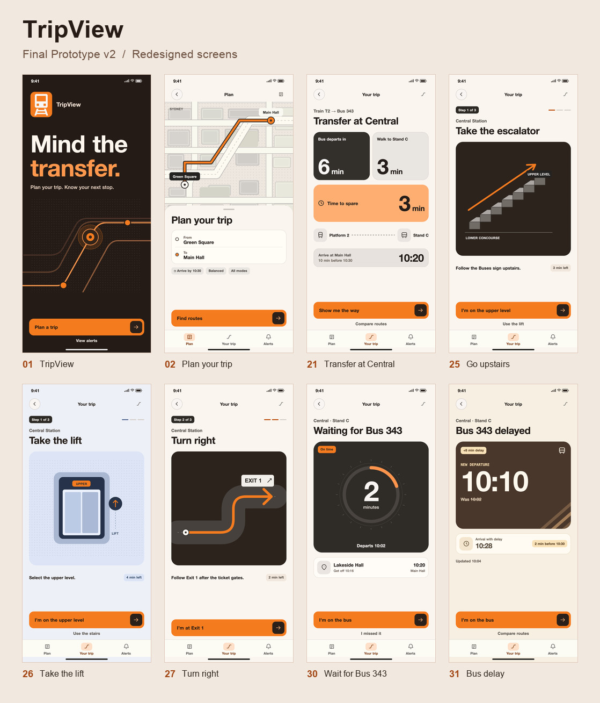

# Transfer Coach

**Designing a decision layer for the three minutes that decide a commute.**

**Portfolio:** [View the portfolio](https://katherine0292.github.io/transfer-coach-final-prototype/portfolio/) · [page source](portfolio/)

An independent, commissioned UX project for TripView: research, interaction design, a 38-screen high-fidelity prototype, and a three-method evaluation for a mobile feature that helps commuters decide what to do during a public transport transfer, especially when something goes wrong.

| | |
|---|---|
| **Role** | UX researcher and interaction designer, end to end (research, concept, prototype, evaluation) |
| **Client** | TripView (Sydney public transport journey planner) |
| **Timeline** | 2026 |
| **Deliverables** | Research synthesis, persona and journey map, two concepts, low / mid / high-fidelity prototypes, interactive web prototype, evaluation report |
| **Focus areas** | Decision support under time pressure, trust in real-time information, error recovery, explainable status design |



## The problem

Journey planners are good at the plan made at home. They are weak in the minutes that follow a delay, a missed service or a wrong stop. In those minutes a commuter is asking three questions the app rarely answers together:

1. **Can I still make the next service?** (departure countdown, walking time, spare time)
2. **Will I still arrive on time?** (arrival at the destination against the event, not the bus)
3. **If not, what should I do right now?** (a ranked, ready-to-start alternative)

The brief asked for a mobile experience that keeps these questions separate and answers them at a glance, using one sample trip: Green Square, Train T2, Central Station, Stand C for Bus 343, to Main Hall at Lakeside Hall, for a 10:30 start.

## What I found

Desk research, interviews and affinity mapping converged on four problems:

- **Uncertainty felt worse than missing the service.** Knowing the next option straight away brought relief.
- **Sudden changes damaged trust.** "On time" jumping to "5 min late" made commuters stop believing the app.
- **Station walking time was hard to judge.** Exits, platforms and stands were unclear, and indoor GPS was often wrong.
- **People wanted a confidence signal, not a time.** Comfortable, tight or unlikely, and a plan if it fails.

## The solution

Transfer Coach is a **decision layer on top of existing real-time data**, not a new journey planner. Across 38 screens it covers planning, walking, platform and stand guidance, waiting, boarding, delay handling, missed services, wrong-stop recovery and arrival.

| Design decision | Why | Where |
|---|---|---|
| Show departure countdown, walk time and spare time together, and keep the arrival time separate | The brief's core test: catching the bus and arriving on time are different questions | Screens 21, 10 |
| Add an explicit **delayed** state: old time struck through, new time, +8 min, arrival with delay included | The most severe usability finding: the app said "2 min" while the stop display said 8 min late | Screens 12, 31 |
| Replace "Transfer complete" with "You're at Stand C" | Participants in every scenario said they had not boarded yet | Screen 29 |
| Lead recovery options with arrival time and minutes before the event | Users compared every option with the deadline in their heads | Screens 13, 15, 32, 36 |
| Guide with landmarks, pictograms and short sentences, plus a "Fix my position" entry | Indoor GPS fails; "Level +1" was called engineer-like | Screens 09, 22 to 28 |
| Choosing a new route leads straight into guidance | Participants had no way to start after selecting a backup | Screens 16, 37 |
| Dedicated recovery flows for a missed train, missed bus and wrong stop | No path existed in the first prototype | Screens 13 to 15, 18 to 20, 32 to 33, 36 to 38 |

## Interactive prototype

[`prototype/index.html`](prototype/index.html) is a clickable version of all 38 screens with the full happy path and every disruption branch wired up, plus a "Design notes" panel that links each screen to the finding behind it.

```bash
cd prototype
python3 -m http.server 8080
# open http://localhost:8080
```

You can also open the file directly in a browser. Use the **Test a disruption** buttons to trigger a delayed train, missed train, wrong stop, delayed bus, lost-in-station or stay-or-switch state. Press **H** to show every tappable area. All times, routes and delays are demo data.

## Process and evidence

| Stage | What was done | Output |
|---|---|---|
| Research | Desk research of commuting HCI literature, interviews with commuters, affinity map with six themes | [docs/02-research.md](docs/02-research.md) |
| Synthesis | Persona, experience story and four-phase journey map | [docs/03-persona-and-journey.md](docs/03-persona-and-journey.md) |
| Concepts | Two concepts compared; Transfer Coach selected and extended with landmark-based guidance | [docs/04-concepts.md](docs/04-concepts.md) |
| Prototyping | Hand-drawn low fidelity, 21-screen mid fidelity, 38-screen high fidelity, interactive web prototype | [docs/05-design-process.md](docs/05-design-process.md) |
| Evaluation | Expert heuristic review, 7 moderated usability sessions across 3 scenarios, 2 experience journals | [docs/06-evaluation.md](docs/06-evaluation.md) |
| Outcomes | Results, limitations and next steps | [docs/07-outcomes-and-next-steps.md](docs/07-outcomes-and-next-steps.md) |

### Evaluation at a glance

- **13 recommendations** came out of usability testing. **8** are fully built into the high-fidelity prototype, **4** are partly built, **1** (editable arrive-by preference) is open.
- The mid-fidelity prototype worked when the trip went to plan and failed when reality changed: no delayed state, an early "Transfer complete", and backup routes that were hard to compare.
- Experience journals showed residual stress that usability testing did not: time shown against the bus instead of the event, uncertainty about whether a delay was already included, and unclear trip stage.

## The AI product angle

Transfer Coach is designed as the interface for a prediction system, even though the prototype uses scripted data. The design questions that matter for AI-assisted products are all present:

- **Calibrated trust.** A single label such as "High confidence" was not believed when it contradicted what people could see. The final design shows the evidence instead: live label, update time, delay included.
- **Explainable status.** Every status says what it is based on and what it means for the destination, not only the next vehicle.
- **Graceful failure.** Manual fallbacks ("I missed it", "Fix my position") stay available whenever live data and the real world disagree.
- **Proactive but not noisy.** Alerts explain impact on this trip and offer the next action, instead of listing network disruptions.
- **Personalisation hooks.** The first concept proposed learning each commuter's walking and interchange pace and preparing a backup route before a connection fails. These are documented as next-step opportunities in [docs/07-outcomes-and-next-steps.md](docs/07-outcomes-and-next-steps.md).

No model was trained and no live feed is connected. The prototype demonstrates the interaction design, not predictive accuracy.

## Repository guide

```
README.md
docs/                       Case study, written in sequence
prototype/                  Interactive web prototype (open index.html)
assets/
  research/                 Affinity map, user journey map
  prototypes/
    low-fidelity/           Hand-drawn style sketches
    mid-fidelity/           21-screen flow used in usability testing
    high-fidelity/          Final overview image and PDF of all screens
  screens/                  38 final high-fidelity screens (PNG)
```

## Notes on data

Participant quotes and observations are summarised and anonymised. No names, recordings or transcripts are published. Trip data, times and disruptions are demo data for one sample journey.
