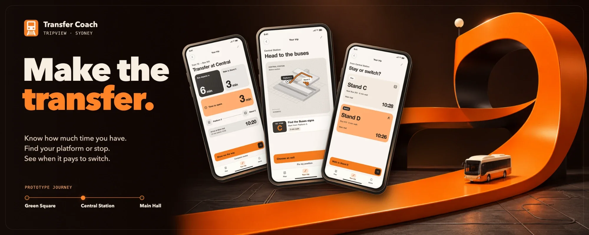
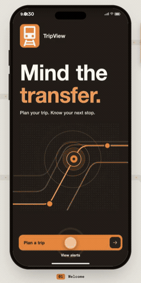
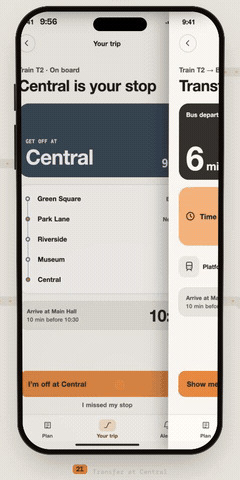
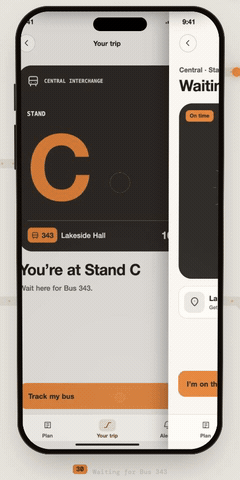
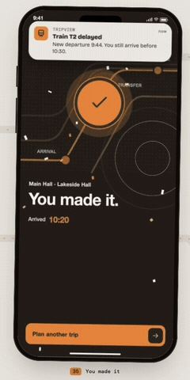
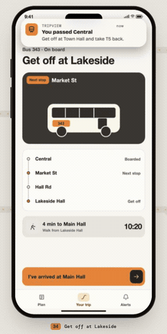
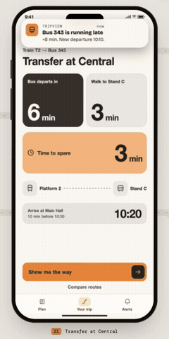

<div align="center">

# Transfer Coach

**Make the transfer.**

A mobile decision layer for the minutes between services: know how much time you have, find your next platform or stand, and recover when the journey changes.

**Independent UX and interaction design commission · Katherine Lin**

[**Explore the Transfer Coach portfolio**](https://katherine0292.github.io/Transfer-Coach/portfolio/)

[Try the interactive prototype](https://katherine0292.github.io/Transfer-Coach/prototype/#screen-01) · [Watch the complete English walkthrough](https://katherine0292.github.io/Transfer-Coach/assets/recordings/transfer-coach-walkthrough-1080p.mp4)



</div>

## At a glance

| | |
| --- | --- |
| **Problem** | A delay, missed service or unfamiliar interchange leaves commuters unsure whether they can catch the next service, arrive on time, or choose a better option. |
| **Audience** | Sydney public transport commuters making time-sensitive transfers, including people navigating unfamiliar stations. |
| **Solution** | Separate departure and destination clocks, landmark-based guidance, and ranked recovery options that lead straight into the next action. |
| **My role** | End-to-end research, synthesis, concept development, interaction design, prototyping and evaluation for a TripView feature commission. |
| **Evidence** | Desk research, commuter interviews and affinity mapping; expert heuristic review, seven scenario-based usability sessions and two structured experience journals. |
| **Status** | A 38-screen high-fidelity browser prototype with a complete journey and six disruption scenarios. Journey data are simulated; the final design has not been retested with users. |

## The experience

Plan around the event, follow the interchange one step at a time, and keep a clear way forward when a connection fails.

<table>
<tr>
<td width="33%" valign="top" align="center">

<p><strong>Plan for when you need to arrive</strong></p>
<p>Arrive-by time, travel preferences, transport modes and routes led by arrival time.</p>
</td>
<td width="33%" valign="top" align="center">

<p><strong>Find the next platform or stand</strong></p>
<p>Time to spare, visible landmarks, exit choices and one instruction at a time.</p>
</td>
<td width="33%" valign="top" align="center">

<p><strong>Keep the destination in view</strong></p>
<p>Separate departure and arrival clocks, a clear trip stage and confirmation at the destination.</p>
</td>
</tr>
<tr>
<td width="33%" valign="top" align="center">

<p><strong>Recover from a missed connection</strong></p>
<p>Revised times, comparable alternatives and guidance that starts with the choice.</p>
</td>
<td width="33%" valign="top" align="center">

<p><strong>Get back after a wrong stop</strong></p>
<p>The current location, the return platform and the new arrival time stay explicit.</p>
</td>
<td width="33%" valign="top" align="center">

<p><strong>Know when it pays to switch</strong></p>
<p>Compare waiting with walking to another stand, then confirm the replacement service.</p>
</td>
</tr>
</table>

The previews show actual browser operations. The [complete English walkthrough](https://katherine0292.github.io/Transfer-Coach/assets/recordings/transfer-coach-walkthrough-1080p.mp4) covers all 38 screens and all six disruption scenarios in Full HD (1920 × 1080), with embedded English captions, original background music and interaction sounds. [Download the English subtitles](assets/recordings/transfer-coach-english.srt).

The prototype demonstrates interaction design using scripted journey data. Planning fields and preference screens illustrate the intended choices; no live route calculation, vehicle feed or indoor positioning service is connected.

## The problem

Journey planners are good at the plan made at home. They are weak in the minutes that follow a delay, a missed service or a wrong stop. In those minutes a commuter is asking three questions the app rarely answers together:

1. **Can I still make the next service?** (departure countdown, walking time, spare time)
2. **Will I still arrive on time?** (arrival at the destination against the event, not the bus)
3. **If not, what should I do right now?** (a ranked, ready-to-start alternative)

The brief asked for a mobile experience that keeps these questions separate and answers them at a glance, using one sample trip: Green Square, Train T2, Central Station, Stand C for Bus 343, to Main Hall at Lakeside Hall, for a 10:30 start.

## What I found

Desk research, interviews and affinity mapping converged on four problems:

- **Uncertainty felt worse than missing the service.** Knowing the next option straight away brought relief.
- **Sudden changes damaged trust.** "On time" jumping to "5 min late" made commuters stop believing the app.
- **Station walking time was hard to judge.** Exits, platforms and stands were unclear, and indoor GPS was often wrong.
- **People wanted a confidence signal, not a time.** Comfortable, tight or unlikely, and a plan if it fails.

## The solution

Transfer Coach is a **decision layer on top of existing real-time data**, not a new journey planner. Across 38 screens it covers planning, walking, platform and stand guidance, waiting, boarding, delay handling, missed services, wrong-stop recovery and arrival.

| Design decision | Why | Where |
|---|---|---|
| Show departure countdown, walk time and spare time together, and keep the arrival time separate | The brief's core test: catching the bus and arriving on time are different questions | Screens 21, 10 |
| Add an explicit **delayed** state: old time struck through, new time, +8 min, arrival with delay included | The most severe usability finding: the app said "2 min" while the stop display said 8 min late | Screens 12, 31 |
| Replace "Transfer complete" with "You're at Stand C" | Participants in every scenario said they had not boarded yet | Screen 29 |
| Lead recovery options with arrival time and minutes before the event | Users compared every option with the deadline in their heads | Screens 13, 15, 32, 36 |
| Guide with landmarks, pictograms and short sentences, plus a "Fix my position" entry | Indoor GPS fails; "Level +1" was called engineer-like | Screens 09, 22 to 28 |
| Choosing a new route leads straight into guidance | Participants had no way to start after selecting a backup | Screens 16, 37 |
| Dedicated recovery flows for a missed train, missed bus and wrong stop | No path existed in the first prototype | Screens 13 to 15, 18 to 20, 32 to 33, 36 to 38 |

## Interactive prototype

[`prototype/index.html`](prototype/index.html) is a clickable version of all 38 screens with the full happy path and every disruption branch wired up, plus a "Design notes" panel that links each screen to the finding behind it.

```bash
cd prototype
python3 -m http.server 8080
# open http://localhost:8080
```

You can also open the file directly in a browser. Use the **Test a disruption** buttons to trigger a delayed train, missed train, wrong stop, delayed bus, lost-in-station or stay-or-switch state. Press **H** to show every tappable area. All times, routes and delays are demo data.

## Process and evidence

| Stage | What was done | Output |
|---|---|---|
| Research | Desk research of commuting HCI literature, interviews with commuters, affinity map with six themes | [docs/02-research.md](docs/02-research.md) |
| Synthesis | Persona, experience story and four-phase journey map | [docs/03-persona-and-journey.md](docs/03-persona-and-journey.md) |
| Concepts | Two concepts compared; Transfer Coach selected and extended with landmark-based guidance | [docs/04-concepts.md](docs/04-concepts.md) |
| Prototyping | Hand-drawn low fidelity, 21-screen mid fidelity, 38-screen high fidelity, interactive web prototype | [docs/05-design-process.md](docs/05-design-process.md) |
| Evaluation | Expert heuristic review, 7 moderated usability sessions across 3 scenarios, 2 experience journals | [docs/06-evaluation.md](docs/06-evaluation.md) |
| Outcomes | Results, limitations and next steps | [docs/07-outcomes-and-next-steps.md](docs/07-outcomes-and-next-steps.md) |

### Evaluation at a glance

- **13 recommendations** came out of usability testing. **8** are fully built into the high-fidelity prototype, **4** are partly built, **1** (editable arrive-by preference) is open.
- The mid-fidelity prototype worked when the trip went to plan and failed when reality changed: no delayed state, an early "Transfer complete", and backup routes that were hard to compare.
- Experience journals showed residual stress that usability testing did not: time shown against the bus instead of the event, uncertainty about whether a delay was already included, and unclear trip stage.

## Repository guide

```
README.md
docs/                       Project documents, in sequence
prototype/                  Interactive web prototype (open index.html)
assets/
  research/                 Affinity map, user journey map
  prototypes/
    low-fidelity/           Hand-drawn style sketches
    mid-fidelity/           21-screen flow used in usability testing
    high-fidelity/          Final overview image and PDF of all screens
  screens/                  38 final high-fidelity screens (PNG)
```

## Notes on data

Participant quotes and observations are summarised and anonymised. No names, recordings or transcripts are published. Trip data, times and disruptions are demo data for one sample journey.
