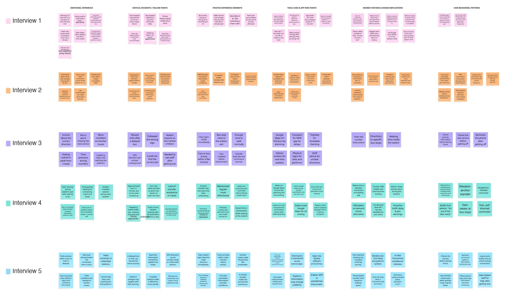

# 02 · Research

Research had one purpose: find out what commuters actually need in the few minutes of a transfer, and what makes that moment fail.

## Methods

| Method | Purpose |
|---|---|
| Desk research | Map what HCI research already says about commuting experience and technology for commuters |
| Semi-structured interviews | Understand real transfers, moments of doubt, tools used and personal workarounds |
| Affinity mapping | Synthesise interview notes into themes and design implications |

## Desk research

The reviewed literature covers a 2002 to 2020 set of commuting studies. Two groups were examined:

- **Commuting experience:** enjoyment by mode, commuting behaviour and mode choice, engaging experiences in active commuting, driver experience, effect of the commute on work and wellbeing, differences between commuters, and walking and cycling and wellbeing.
- **Technology for commuters:** social and connected experiences, play and entertainment, rest and stress management, safety, and informed, planned and comfortable journeys.

**Takeaway.** Most of the technology examples treat the commute as time to fill, with social, playful or calming apps. The informed-and-planned group (real-time trip planning, crowdsourced bus occupancy, comfort-aware recommendation) is the closest to this project, but none of the listed examples addresses the decision moment inside a transfer.

## Interviews

The interview guide moves from context to a recent commute, then to the transfer itself, then to tools and workarounds. Core questions:

- Walk me through your most recent commute, from leaving the house.
- How do you feel during the in-between part of the journey, and why?
- Tell me about a time a transfer went badly. What did you do? How did you feel? Did it change how you travel now?
- What do you use to plan or check your journey? What do you not trust?
- Apart from apps, what tricks have you developed to make the transfer easier?
- If you could change one thing about your commute tomorrow, what would it be?

The guide includes probes for physical, social and environmental factors such as peak hour, luggage, weather and crowding.

## Affinity map

Interview notes were grouped under six themes (see [affinity-map.png](../assets/research/affinity-map.png)):

1. Emotional experience
2. Critical incidents and failure points
3. Positive experience moments
4. Tools used and app pain points
5. Desired features and design implications
6. User behavioural patterns

## Insights

| # | Insight | Evidence from the map | Design implication |
|---|---|---|---|
| 1 | **Uncertainty is worse than the miss.** Not knowing whether to run, wait or reroute causes more stress than missing the service. Knowing the next option brings immediate relief. | Heart rate jumps at a short countdown; "doing maths in my head"; knowing the next option creates relief | Always present a next move, never only a status |
| 2 | **Silent changes break trust.** "On time" turning into "5 min late", or a "1 min away" bus that never shows up, make commuters stop trusting the app. | App shows "On Time" then jumps to "5 min late"; stops trusting the app after being burned | Show what a status is based on and when it was updated; make changes visible |
| 3 | **Walking time and wayfinding inside stations are the weak link.** Indoor GPS sends people the wrong way, and apps underestimate real station walking time. | Walked towards an exit instead of the metro; had to ask staff after getting lost | Pre-defined landmark guidance that does not depend on GPS |
| 4 | **Commuters want a confidence signal and a plan B.** Not just ETAs, but whether a connection is comfortable, tight or impossible, and what to do. | Show whether a connection is comfortable, tight or impossible; recommend the next realistic option when a connection fails | Pair a plain-language status with ranked backup routes |
| 5 | **Experienced commuters build personal systems.** Buffer time, memorised exits, familiar waiting spots, and a backup route in mind. | Backup routes reduce anxiety; leaves extra buffer for important days | Support existing habits; do not replace them |
| 6 | **Repeated checking drains attention** even on trips that go well. | Repeated checking consumes attention even on successful trips | One glance, then put the phone away |

These insights fed the persona, journey map and two concepts that follow.
