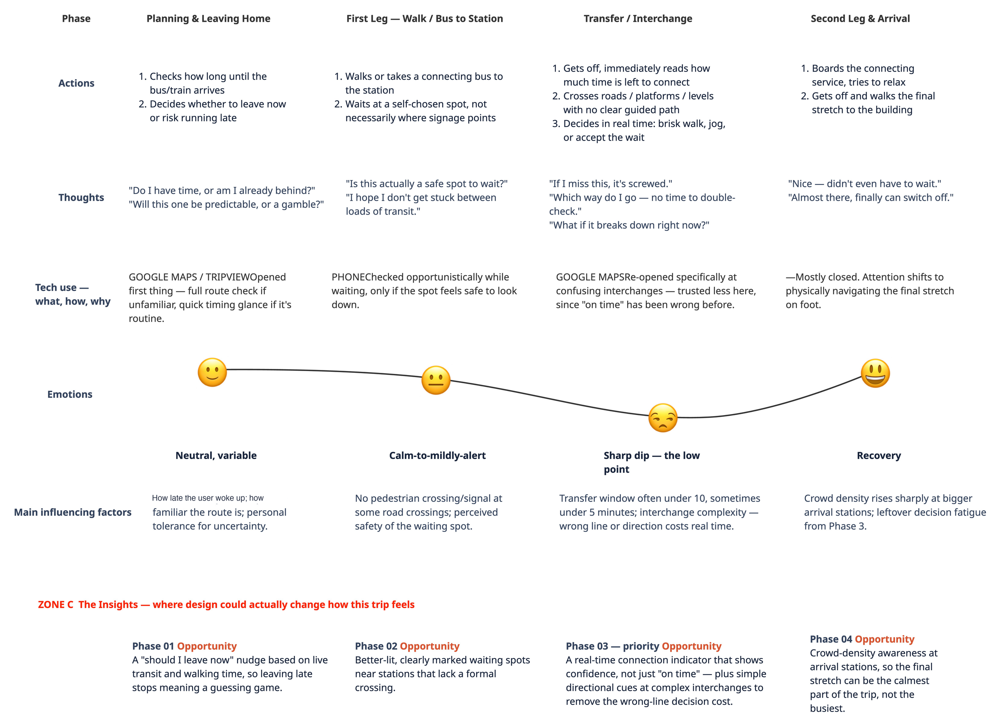

# 03 · Persona and journey

## Persona: Jamie Park

**21, commuter, outer Sydney.** One to three transfers per trip (bus, train, metro or light rail), three to four days a week, for one to three years.

> "Every transfer is a small gamble. I've built my own tricks to tip the odds in my favour, but one bad piece of information can still undo my whole morning."

| | |
|---|---|
| **Core tension** | Routine and control versus sudden uncertainty |
| **Background** | Lives in an outer suburb, treats the daily commute as something to be actively managed and optimised. Over time has built personal systems: a memorised transfer sequence, a backup route, a preferred waiting spot, and a larger buffer on high-stakes days such as exams or presentations |
| **Technology use** | Checks a transit app before leaving home, on board and right before a transfer. Cross-checks the app against physical signage, especially after being burned by wrong information |
| **What drives them** | Minimising wasted time and decision fatigue at transfers. Avoiding the "domino effect", where one small delay early on costs the whole morning |
| **Emotional preference** | Wants predictability and a sense of control. Comfortable with routine, but feels a sharp stress spike the moment a "sure thing" turns uncertain |
| **Values** | Reliability over comfort |
| **Frustrations** | Unpredictable wait times, wrong data at the worst moment, decision fatigue at interchanges |
| **Wants** | Confidence that a connection will hold, and to reclaim commute time |

**Personal hacks:** leaves a bigger buffer on important days; memorises which exit or carriage lines up with the next platform; keeps a backup route in mind; waits in a specific, familiar spot.

## Experience story: the domino effect

At 7:14, Jamie stands in the usual spot, a place worked out months ago because it lines up with the stairs at the next station. The app says the connecting service is "On Time". The train arrives two minutes late and the app never updates. Jamie works out the maths instantly: a connection with a comfortable three-minute buffer now has less than a minute. A half-run through the carriage and across the platform, in a small crowd making the same calculation.

Jamie makes the connection with seconds to spare. The frustration is not about the delay itself, since delays happen. It is that the one tool relied on every morning gave false confidence at the exact moment it mattered. A plain "delayed" message two minutes earlier would have meant no sprint at all.

**Trigger:** real-time information fails to update, silently narrowing an already tight transfer window.
**Feelings:** comfort and control, then a sharp stress spike, then lingering frustration rather than relief.
**Underlying wish:** not faster transport, but more honest transport information.

## Journey map

Four phases of a transfer trip, with actions, thoughts, technology use, emotions and influencing factors. The low point is the transfer itself.

| Phase | Emotional state | Opportunity |
|---|---|---|
| 1. Planning and leaving home | Neutral, variable | A "should I leave now" nudge based on live transit and walking time |
| 2. First leg: walk or bus to the station | Calm to mildly alert | Better-lit, clearly marked waiting spots near stations that lack a formal crossing |
| 3. Transfer / interchange | **Sharp dip, the low point** | **Priority.** A real-time connection indicator that shows confidence, not just "on time", plus simple directional cues at complex interchanges |
| 4. Second leg and arrival | Recovery | Crowd-density awareness at arrival stations so the final stretch is the calmest part, not the busiest |

Phase 3 was chosen as the design focus. The transfer window is often under ten minutes, sometimes under five, and a wrong line or direction costs real time.
