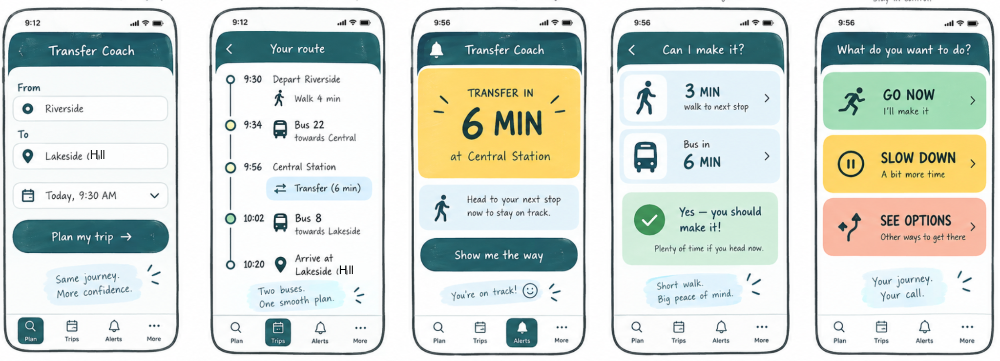
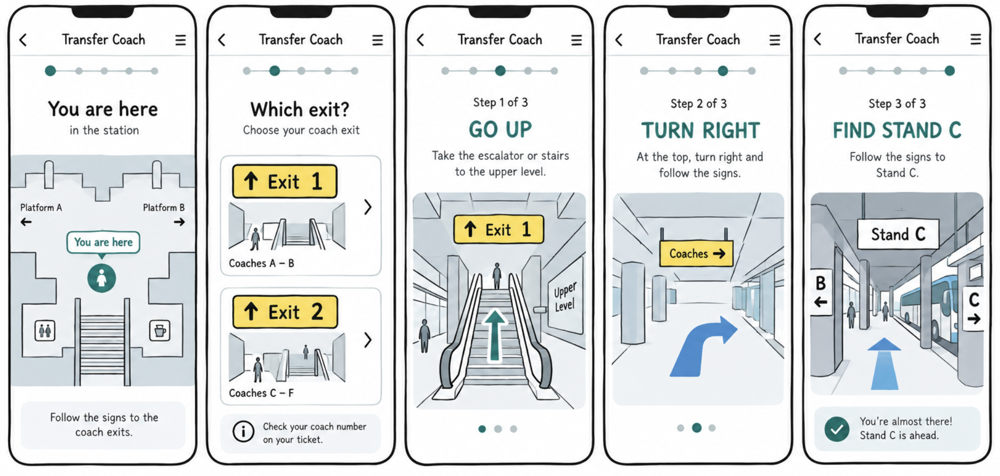
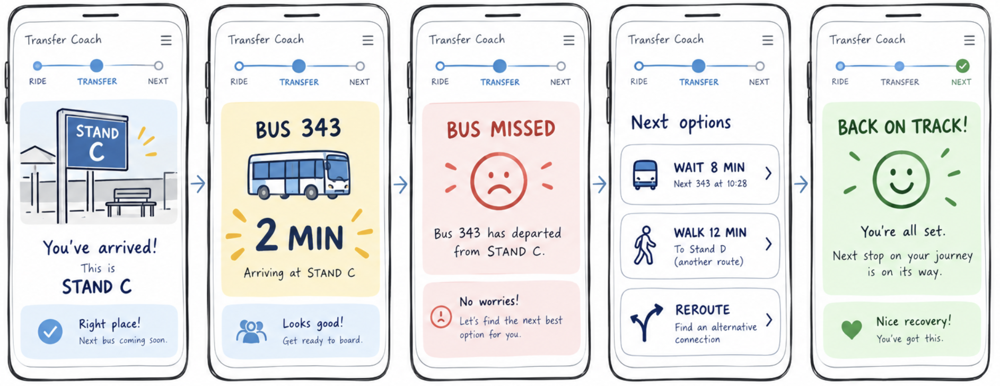
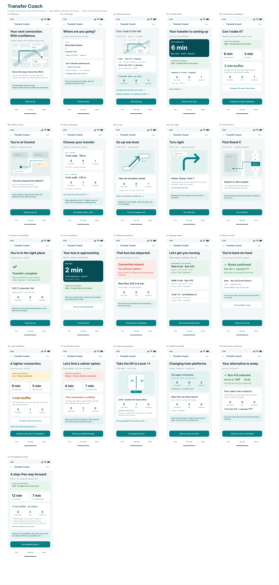
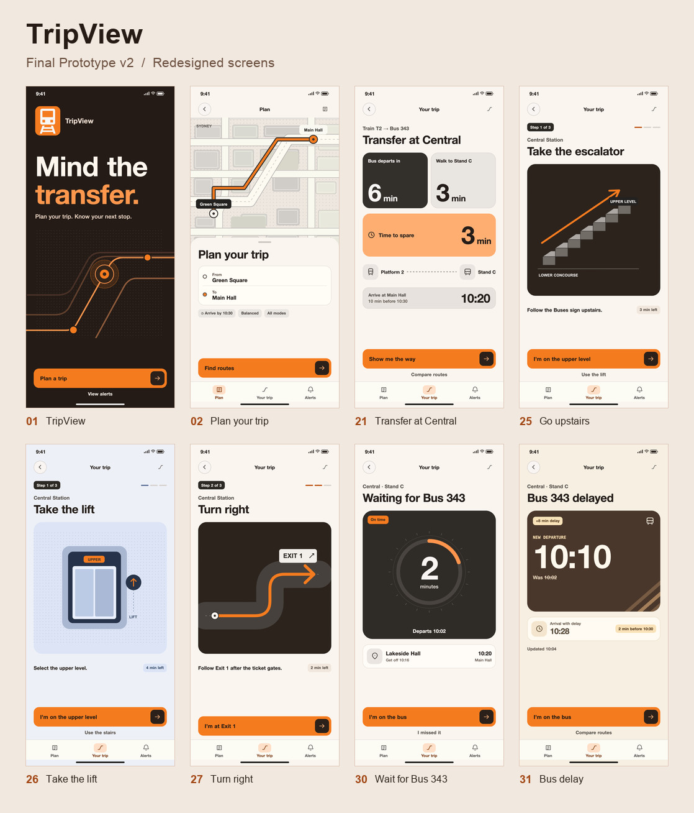

# 05 · Design process and prototypes

The design went through four versions. Each version was built to answer a specific question.

| Version | Fidelity | Question it answered |
|---|---|---|
| v1 | Hand-drawn style sketches | Which screens and flows does a transfer need? |
| v2 | Mid fidelity, 21 screens | Can people follow the transfer? (used for usability testing) |
| v3 | High fidelity, 38 screens | How are the changes experienced in a scenario? (used for experience evaluation; not a final usability retest) |
| v4 | Final screens and interactive web prototype | Is the experience coherent end to end, including every disruption? |

## v1 · Low fidelity

Sketches covered trip planning, a transfer countdown, a "Can I make it?" breakdown, three action choices (go now, slow down, see options), step-by-step station navigation, backup routes and recovery after a missed bus.

## v2 · Mid fidelity

21 screens in a clean visual style, framed as a transfer feature inside a journey planner. The sample trip ran from Riverside Station via Central Station to Bus 343 from Stand C and on to Lakeside Hall. Key ideas:

- A transfer alert with a countdown and a confidence label
- "Can I make it?" breaking time into minutes to departure, walk time and buffer
- Exit comparison with walking time and counts of stairs, lifts and escalators
- Backup routes after a missed bus, and a step-free recovery path

Some screens were not linked, so sessions sometimes advanced screens by hand. This version is the one used for usability testing.

## v3 · High fidelity (38 screens)

The high-fidelity redesign incorporated findings from the mid-fidelity heuristic review and usability sessions. The process:

1. Collected the data sheets and transcripts from every session and summarised the feedback in one place.
2. Annotated each mid-fidelity screen with the problems found and checked each against the heuristic review.
3. Rebuilt the prototype as 38 screens in six functional groups: planning; the train leg; train recovery (change route, wrong stop); transfer alert and station guidance; the bus leg; and bus recovery.
4. Re-checked the new screens against the earlier findings using the same heuristics.

**Main changes from v2 to v3**

- A live status card in plain words instead of a "High / Low / Danger" confidence label
- "You're at Stand C" instead of an early "Transfer complete"
- Pictograms instead of technical wording such as "Level +1"
- A "Bus delayed" state
- Ranked backup-route cards with a "min to spare" label
- Route changes that lead straight into guidance
- A new wrong-stop recovery flow
- A stop list on the train and the bus
- Fewer duplicate buttons and pages
- A train leg before the transfer, so the whole trip can be followed

## v4 · Final screens and interactive prototype

The final set is 38 screens with three tabs (Plan, Your trip, Alerts) and a consistent visual system: warm paper backgrounds for normal states, dark cards for live countdowns, amber for delays, blue for recovery. Arrival times are always paired with minutes before the event.

The full 38-screen set is in [assets/screens](../assets/screens) and as one PDF in [assets/prototypes/high-fidelity](../assets/prototypes/high-fidelity).

### Screen groups

| Group | Screens | Purpose |
|---|---|---|
| Welcome and planning | 01 to 05 | Set trip, compare routes, preferences and modes |
| Trip overview and alerts | 06, 07 | Whole trip at a glance; service alerts that explain impact |
| Train leg | 08 to 11 | Walk to station, find the platform, wait, ride, get off |
| Train recovery | 12 to 15 | Delayed train, missed train, bus or train choice |
| Direct bus route | 16, 17 | Walk to Stand A, wait for Bus 410 |
| Wrong-stop recovery | 18 to 20 | Return via T5 after riding past Central |
| Transfer at Central | 21 to 29 | Time check, station guidance, exit choice, steps, arrive at Stand C |
| Bus leg and recovery | 30 to 34, 36 to 38 | Wait, delayed bus, next move, stay or switch, ride and get off |
| Arrival | 35 | Arrival confirmation |

### Design principles

1. **Status first.** The current state and the next action are always the largest elements.
2. **Two clocks.** The next service and the destination are shown separately and never merged.
3. **Say what the number is based on.** Live label, update time and "delay included".
4. **Words that match the world.** "You're at Stand C", "Head downstairs", not system terms.
5. **No dead ends.** Every disruption screen offers a next move, and choosing one starts guidance.
6. **Different states for different problems.** A delay and a missed service use different colour, wording and options.

## Interactive prototype

[`prototype/index.html`](../prototype/index.html) links all 38 screens into the full flow. It adds:

- Hotspots on every control, with a back stack and tab navigation
- Six one-tap disruption scenarios that deliver a notification and jump to the right screen
- A trip progress rail (plan, walk, platform, ride, interchange, last leg, arrive)
- An in-universe clock that advances with the story
- A "Design notes" panel that ties each screen to the finding behind it
- A hotspot overlay (press H), keyboard shortcuts and reduced-motion support

Motion is used to explain state changes: forward steps push, back steps pop, card choices expand from the tap point, disruptions shake and flash amber, arrival bursts from the success mark.
